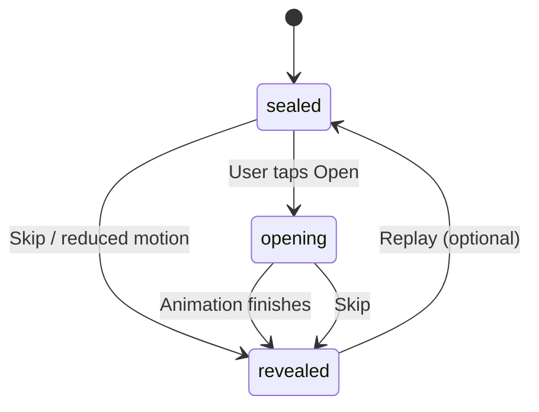

# Envelope Animation & Audio Specification

## Envelope state machine


## Sequence
1. Display ivory background, powder-blue envelope, optional champagne-gold seal and admin-configured label.
2. User taps Open. Begin flap rotation (CSS 3D), seal disappearance and card translation; keep elements accessible.
3. As part of the same user gesture, attempt audio playback if enabled and track configured. Catch rejected playback promises.
4. Card transitions to full invitation hero. Scroll/keyboard navigation becomes available immediately or after short reveal.
5. Show visible Skip animation control and persistent sound toggle; do not replay automatically on route changes.

## Audio rules
- Never assume unmuted autoplay; browsers generally require a user gesture.
- Opening tap may initiate soundtrack; default volume low (e.g., 0.2) and admin-adjustable.
- Music icon clearly indicates playing/muted state, keyboard accessible and always available.
- On blocked playback, continue silently with no disruptive error.
- Pause/stop when user explicitly mutes; optionally pause on hidden tab; respect system and browser preferences.
- Fade-in/out only after playback is authorized; audio loops only if enabled.
- No bundled copyrighted commercial music without permission. Admin supplies owned/licensed audio.

## Countdown
```ts
const remainingMs = Math.max(0, new Date(eventStartsAt).getTime() - Date.now());
const days = Math.floor(remainingMs / 86_400_000);
const hours = Math.floor((remainingMs / 3_600_000) % 24);
const minutes = Math.floor((remainingMs / 60_000) % 60);
const seconds = Math.floor((remainingMs / 1_000) % 60);
```
Use an IANA timezone for event configuration and convert to an unambiguous UTC timestamp server-side. Recompute from the current clock on every tick (don't decrement a counter). After zero, show the configured post-event message.

## Performance and accessibility
Use transform/opacity animations, avoid expensive layout properties, prefetch only first-screen assets, lazy-load gallery, and test low-end mobile devices. Honor `prefers-reduced-motion`, provide skip, keep focus stable, and don't trap keyboard or screen-reader users in the opening sequence.
