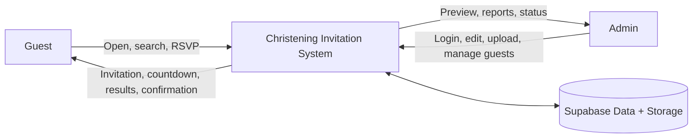
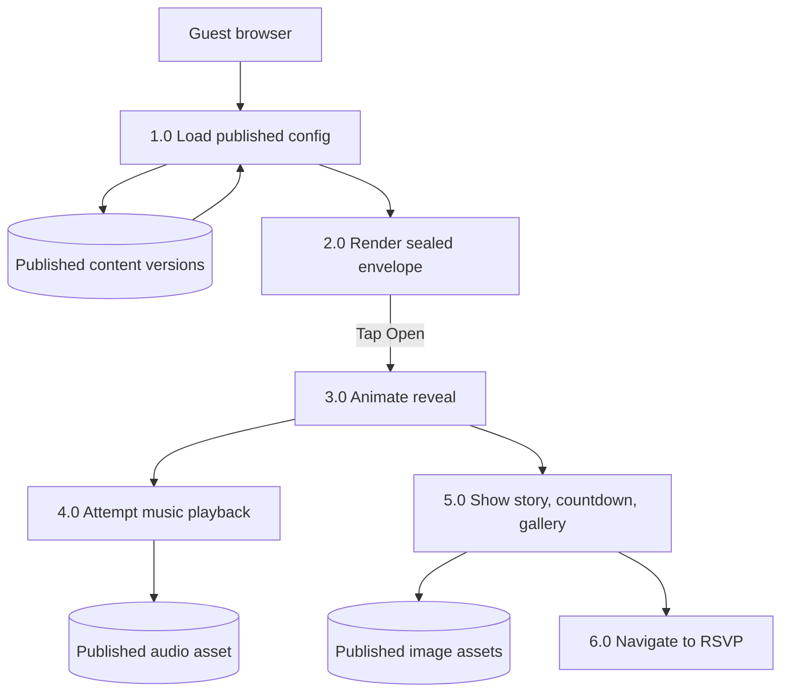
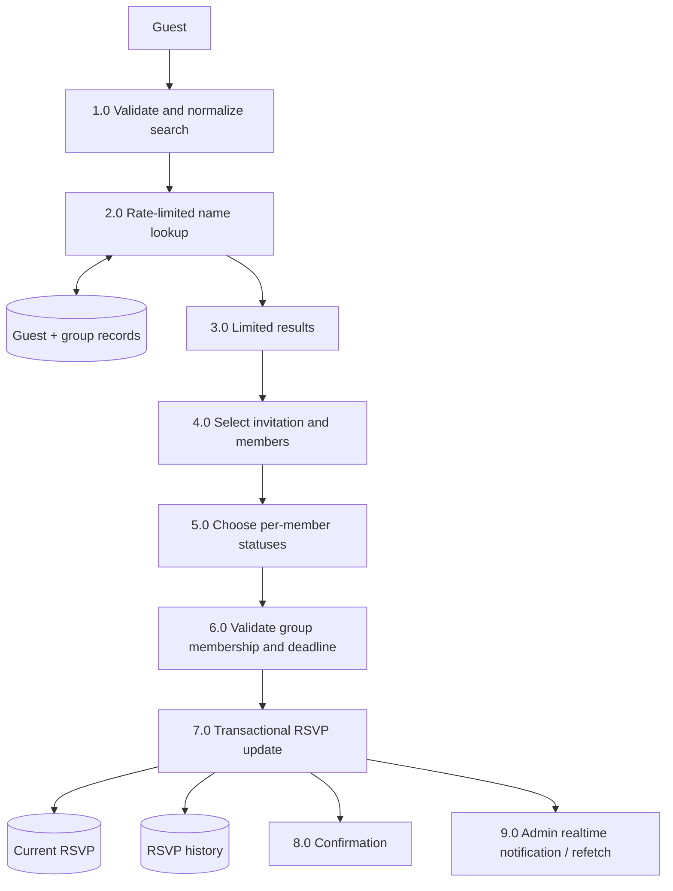
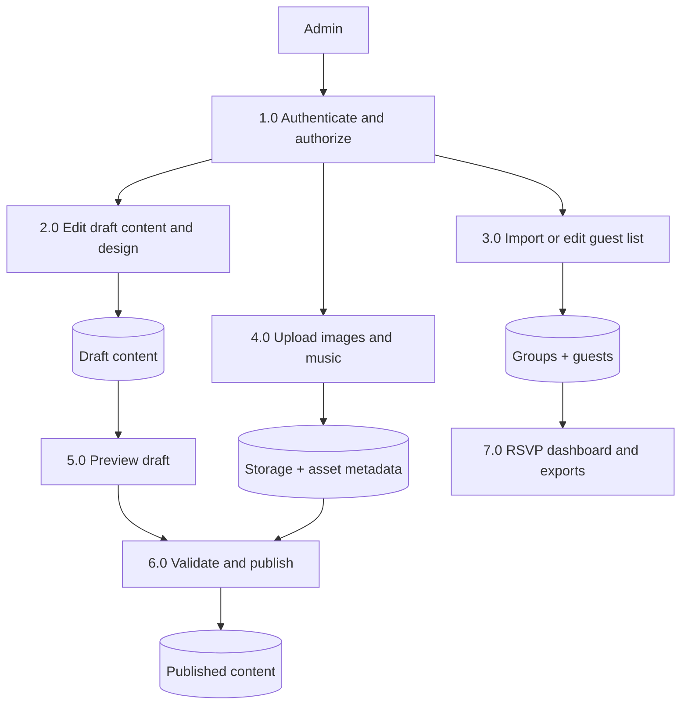

# Data Flow Diagrams (DFD) — v2.0

## Level 0: context

## Level 1: public invitation and media

## Level 1: name lookup and RSVP

## Level 1: admin CMS and guest management

## Trust boundaries
- Guest → Edge Functions: anonymous, untrusted; enforce validation, limits and abuse controls.
- Admin → authenticated APIs: verify JWT and role on every privileged operation.
- Storage → public browser: serve only published assets through approved URLs.
- RSVP transaction → DB: only controlled server-side operations may change anonymous guest statuses.
- Music playback: user gesture and browser permission determine whether sound begins.
