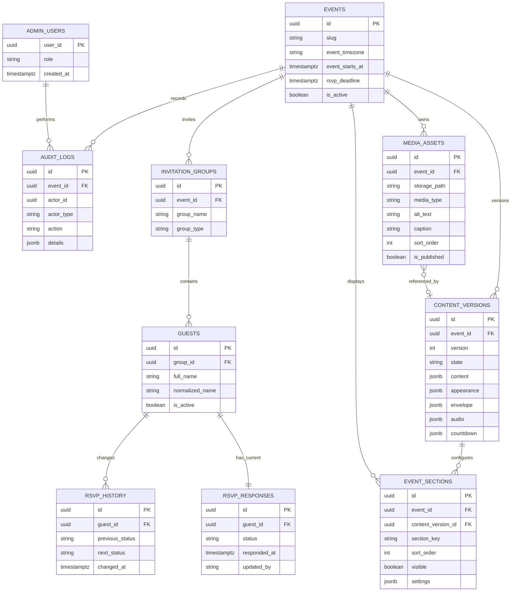

# Entity Relationship Diagram (ERD) — v2.0

## Tables and key columns

### `events`
`id uuid pk`, `slug text unique`, `event_timezone text not null default 'Asia/Manila'`, `event_starts_at timestamptz`, `rsvp_deadline timestamptz`, `is_active boolean`, `created_at`, `updated_at`. Store ceremony/reception schedules and other editable details in versioned content or dedicated schedule rows if multiple timed segments are required.

### `content_versions`
`id uuid pk`, `event_id uuid fk`, `version integer`, `state text check (state in ('draft','published','archived'))`, `content jsonb`, `appearance jsonb`, `envelope jsonb`, `audio jsonb`, `countdown jsonb`, `created_by uuid`, `published_at timestamptz`. Exactly one active published version per event via partial unique index; drafts may coexist subject to CMS policy. `content` includes baby's name, invitation text, church/reception details, dress code, map links, closing text and gallery section configuration. Validate JSON using application schemas and server-side checks.

### `event_sections`
`id uuid pk`, `event_id uuid fk`, `content_version_id uuid fk`, `section_key text`, `sort_order integer`, `visible boolean`, `settings jsonb`. Unique `(content_version_id, section_key)`; verify version belongs to same event.

### `media_assets`
`id uuid pk`, `event_id uuid fk`, `storage_path text unique`, `media_type text`, `mime_type text`, `bytes bigint`, `alt_text text`, `caption text`, `sort_order integer`, `is_published boolean`, `uploaded_by uuid`, `created_at`. Asset IDs referenced in versioned config; ensure referenced asset belongs to event.

### `invitation_groups`
`id uuid pk`, `event_id uuid fk`, `group_name text`, `group_type text check (group_type in ('individual','family'))`, `created_at`.

### `guests`
`id uuid pk`, `group_id uuid fk`, `full_name text`, `normalized_name text`, `lookup_aliases text[]`, `is_active boolean`, `created_at`. Index `normalized_name`; optional `pg_trgm` index for fuzzy suggestions. Do not place unique constraint on names.

### `rsvp_responses`
`id uuid pk`, `guest_id uuid unique fk`, `status text check (status in ('pending','attending','declined'))`, `responded_at timestamptz`, `updated_at timestamptz`, `updated_by text check (updated_by in ('guest','admin'))`. Create a pending response when guest is created, or handle missing as pending consistently.

### `rsvp_history`
`id uuid pk`, `guest_id uuid fk`, `previous_status text`, `next_status text`, `changed_at timestamptz`, `source text`, `request_id uuid`. History is not proof of anonymous submitter identity.

### `admin_users`
`user_id uuid pk fk auth.users`, `role text check (role in ('owner','admin'))`, `created_at`.

### `audit_logs`
`id uuid pk`, `event_id uuid fk`, `actor_id uuid null`, `actor_type text`, `action text`, `entity_type text`, `entity_id uuid`, `details jsonb`, `created_at`.

## Integrity and security
- All foreign keys indexed as appropriate; prevent deleting referenced published assets without safe replacement.
- Keep current RSVP unique by guest ID; update group members atomically with history.
- Admin-only access to drafts, guest lists, raw responses and logs; no direct anonymous SELECT/UPDATE on these tables.
- Use server-controlled functions for public lookup and RSVP; never trust group IDs or member IDs submitted by browser without validating membership.
- Use UUIDs, timestamps with timezone, migration-managed constraints, and database backups.
