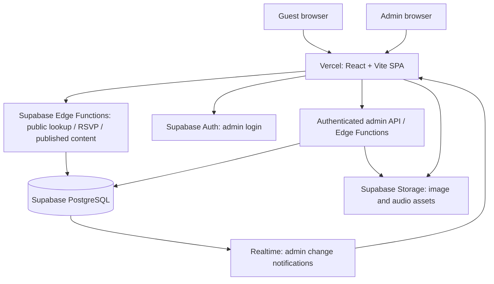

# System Architecture — v2.0

## Component diagram

## Frontend
- Vite SPA, TypeScript, React Router; separate public and admin layouts.
- TanStack Query for remote data; React Hook Form + Zod for CMS forms; Motion for React for animations; Howler.js or native HTMLAudioElement for audio.
- Central `InvitationConfig` schema; components render published configuration, not hardcoded event details.
- Envelope opening is client-only UI state; do not store individual open events unless explicitly needed and privacy-reviewed.
- Music is opt-in via opening gesture, with visible controls. No autoplay assumption.

## Backend responsibilities
- `public-config`: returns only published safe content, section order and public asset URLs.
- `guest-search`: validates search, normalizes, limits result count, throttles, returns only minimal fields and opaque selection references.
- `guest-invitation`: returns minimal members for an explicitly selected group, subject to abuse controls.
- `submit-rsvp`: validates selected group/member IDs and statuses; uses database transaction / controlled RPC to update rows and audit; enforces deadline.
- `admin-*`: requires Supabase Auth JWT and verifies admin role server-side; supports content drafts/publish, guest CRUD/import/export and media metadata.
- Never expose Supabase service-role key to Vite. Edge Functions holding privileged keys must enforce explicit authorization and input validation.

## Data access and RLS
- Tables default-deny anonymous direct access; public endpoints mediate all guest searches and RSVP changes.
- Admin policies check membership in `admin_users` using safe SQL functions or claims with secure verification.
- Public config may be read anonymously only if published; drafts and audit logs are private.
- Use short result limits, per-IP and/or risk-based throttling, request body limits, and monitoring. Name-only flows cannot fully prevent malicious updates.
- Signed URLs for private draft assets; public published assets may be served through public storage/CDN when suitable. Never make private guest records public to enable images.

## Media pipeline
Admin uploads validated images (JPEG/PNG/WebP/AVIF) and audio (MP3/AAC/OGG as supported) to Storage via authenticated upload flow; enforce type, size and content checks; save asset metadata; generate optimized variants where practical; preview; publish references. Use licensed or owned audio only. Store alt text, caption, ordering and active flags.

## Content publication
Draft config -> Zod + server validation -> versioned published snapshot -> public-config endpoint -> TanStack Query cache refresh. Avoid exposing unpublished photos or event details. Maintain revision history and audit publisher/time.

## Countdown and time
Store event start as timestamptz UTC plus IANA timezone. Client calculates difference against current clock each second; optionally refresh time offset from server if drift matters. Clamp negative values to zero and show configured post-event message.

## Deployment
- Vercel: SPA hosting with rewrite fallback to `/index.html`, environment `VITE_SUPABASE_URL`, `VITE_SUPABASE_ANON_KEY` (publishable key only).
- Supabase: SQL migrations, Auth, Edge Functions, Storage buckets, Realtime.
- Secrets remain server-side; configure CSP, CORS allowlist, error tracking, backups, monitoring and rollback.
